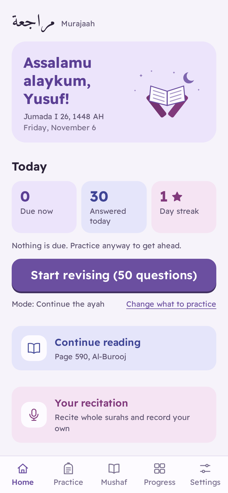
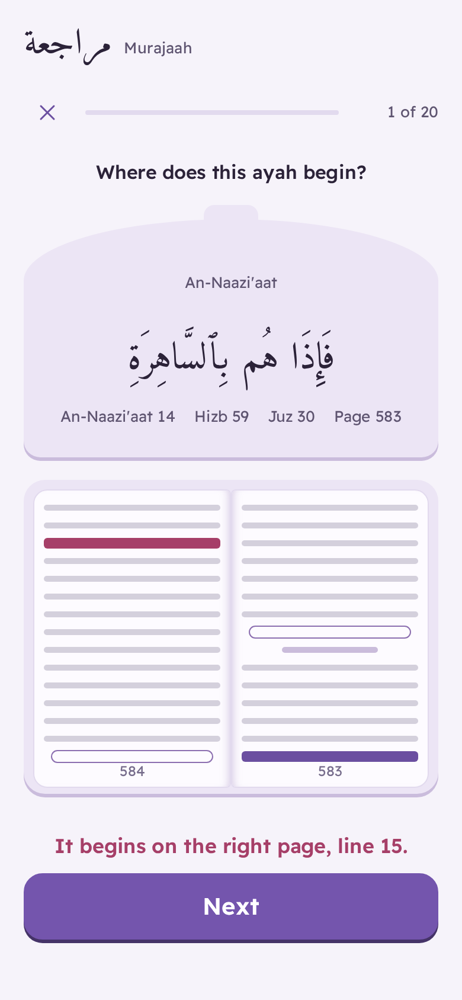

<div align="center">


# Murajaah · مراجعة

**Revise your Qur'an memorization by rub' and by ayah.**
راجِع حفظك للقرآن الكريم بالأرباع والآيات.

[](https://github.com/Noorul-Ayn/murajaah-revision-/actions/workflows/ci.yml)

**[Open the app](https://noorul-ayn.github.io/murajaah-revision-/)**

</div>

Murajaah quizzes you on what you've memorized, and has the full mushaf to read page by page, with an optional English translation. You recite out loud, reveal the answer and mark how it went. The app remembers which ayahs and quarters are weak and asks those more often, using spaced repetition. It works offline, installs on your phone like an app, and can sync your progress across devices.

<p align="center">
  
  
  
  
  
</p>

## Home

Home opens on today's date (Hijri and Gregorian), what's due, what you've answered today and your streak, with one button to start revising. Below it: where you stopped reading in the mushaf, the surah you're closest to recording, and a strip showing how strong your memorized rub's are. The first time, it explains the app and asks what you've memorized. Add your name in Settings and Home greets you with it.

The design aims to be calm and easy for anyone, children included: large buttons, soft colours from one purple family with a tint per quiz mode, and simple grades (Perfect!, Almost, Not yet) with a star when you get one right.

## What it quizzes

| Mode | You see | You do |
| --- | --- | --- |
| **Continue the ayah** (أكمل الآية) | The first few words of an ayah | Recite the rest, and optionally the next 1–3 ayahs |
| **Start of a rub'** (أول الربع) | A quarter by name, e.g. *½ Hizb 27* | Recite how it begins |
| **Name the rub'** (سمِّ الربع) | How a quarter begins | Pick which quarter it is (checked automatically) |
| **Link the quarters** (ربط الأرباع) | The last ayah of a quarter | Recite how the next quarter begins |
| **Where on the page?** (أين في الصفحة؟) | An ayah, beside a drawing of the open mushaf | Tap the line it begins on (checked automatically) |
| **From the meaning** (من المعنى) | What an ayah means, in English | Recite the ayah in Arabic |
| **Tell them apart** (المتشابهات) | The opening of an ayah you once drifted out of, and the ayah you drifted into | Recite the right one, then see where the two differ |

<p align="center">
  
</p>

- **Where on the page.** Many huffaz remember an ayah by where it sits on the page. This mode draws the open Madinah mushaf, odd page on the right, fifteen lines each, and asks you to tap the line an ayah begins on. The first line of the ayah is Perfect; another line of it, or two lines off, is Almost. The surah titles can be shown as a hint. Prints of the Madinah mushaf differ (page 121 starts at Al-Mā'idah 77 in the 1405 AH print and at 78 in the 1421 AH print and later), so you choose yours in Settings, and the page numbers throughout the app follow it.
- **Similar ayahs from your own slips.** When you recite aloud and drift into another ayah (from Al-Baqara 58 into the wording of Al-A'raf 161, say), the app looks up what you said in the whole Qur'an and tells you where you went, with the two ayahs side by side and the differing words coloured. The pair is saved to **Tell them apart**, so you practise exactly the look-alikes you confuse, not a fixed list. If it misheard, tap **Not a mix-up**.

- **Only what you've memorized.** Choose by juz, hizb, surah or any ayah range, and questions only come from there.
- **Weakest first.** Every ayah and quarter has its own memory strength (the [FSRS](https://github.com/open-spaced-repetition/ts-fsrs) algorithm). Missed items come back later in the same session and sooner in future ones.
- **Honest hints.** Reveal one more word, or the surah name. Using a word hint caps that answer at *Almost*.
- **Recite aloud.** Turn on the microphone and recite: words appear as you say them correctly. On a wrong or skipped word you hear a short warning tone (and the phone vibrates), the right word shows in red, and the app waits until you say it. You can start from the beginning of the ayah or go back over it; that isn't counted as a mistake. Carry on past the verse as far as you like: every ayah you recite in full is recorded too. **Next question** grades what was heard and moves on with the microphone still on; **Stop listening** shows the answer to grade yourself. This uses the browser's own speech recognition (Chrome, Edge and Safari; it needs a connection). It hears words, not tajweed, and can mishear, so treat a warning as a prompt to check.
- **Progress map.** All 240 quarters, juz by juz, coloured from weak to strong.
- **The full mushaf.** Open any surah or juz and read the 604 Madani pages one by one, with surah headers and the basmala. Turn pages with the buttons, by swiping, or with the arrow keys, or jump straight to a page number. The app remembers where you stopped.
- **English translation.** Turn it on in the reader to see each ayah followed by its meaning: Saheeh International or Pickthall, chosen in Settings.
- **Listen to reciters.** Choose from 14 reciters, including Alafasy, Abdul Basit, Al-Husary (and his teaching recitation), Al-Minshawi, As-Sudais and Al-Muaiqly. Playback goes ayah by ayah with the basmala before each surah, highlights the ayah being recited, turns the page by itself, and can repeat each ayah up to 10 times or slow down for memorizing. Tap any ayah to play from there. Audio streams from EveryAyah.com.
- **Your recitation.** Recite a whole surah from memory while the app follows you. After three recitations with no slips, on three different days, you can record that surah: the take is followed as you record, and only a take with no slips can be saved. Your recordings are private, kept on your device and, when you're signed in, in a private folder of your account that only you can reach. They play in the mushaf as the reciter **You**, highlighting each ayah as you go.
- **Arabic and English**, with full right-to-left layout, light and dark themes and three Qur'an text sizes.
- **Offline and installable.** The whole mushaf is bundled; after the first visit it works without a connection.
- **Accounts and sync (optional).** Sign in with an emailed link (or a code, if your Supabase project sends one) to keep progress in step across devices. Without an account everything stays on the device. You can also download and restore a backup file.

## The Qur'an text

The text is the [Tanzil Project](https://tanzil.net)'s verified **Uthmani text, riwayat Hafs**, used unchanged and displayed in the Amiri Quran typeface.

The reader follows the page divisions of the Madani mushaf (604 pages), in the print you choose in Settings. The text flows within each page rather than reproducing the printed line breaks; where each ayah sits on the printed lines is used by the page quiz.

Reciting aloud is matched against Tanzil's **plain-spelling text** (Simple Clean), because speech recognition writes modern spelling (الصلاة) rather than Uthmani (ٱلصَّلَوٰةَ). Each plain word is aligned to its Uthmani word for display; all 6,236 ayahs align cleanly (`tests/recitation.test.ts`).

The English translations come from Tanzil: **Saheeh International** (distributed for non-commercial use) and **Pickthall** (1930, public domain). Each is loaded only when you turn the translation on, and is then kept for offline use. A translation conveys the meaning and is not the Qur'an itself.

Rub', juz and page boundaries are checked three ways: against Tanzil's metadata, against the rub' signs (۞) written in the text itself, and against [quran.com](https://quran.com)'s independent data. All 30 juz, 240 quarters and 604 pages agree, with one correction: Tanzil's metadata places the quarter in Al-Hijr at 15:50, but the rub' sign in the text, the printed Madani mushaf and quran.com all have it at **15:49** (نَبِّئْ عِبَادِىٓ). The build uses 15:49 and records the correction. See [`scripts/build-data.mjs`](scripts/build-data.mjs) and [`tests/data.test.ts`](tests/data.test.ts).

## Getting started

You need [Node.js](https://nodejs.org) 22 or newer.

```bash
npm install
npm run dev          # http://localhost:5173
```

This runs the app without accounts; everything is stored in your browser. To turn on sign-in and sync, follow [docs/SETUP.md](docs/SETUP.md).

| Command | What it does |
| --- | --- |
| `npm run dev` | Start the development server |
| `npm run build` | Typecheck and build to `dist/` |
| `npm run preview` | Serve the built app (service worker included) |
| `npm test` | Unit tests: data checks, quiz engine, storage, sync and the database migration |
| `npm run test:e2e` | End-to-end tests in Chromium at phone and desktop sizes |
| `npm run check` | Typecheck, lint, formatting and unit tests together |
| `npm run data:fetch` | Download the latest Tanzil files into `data/tanzil/` and the page layout into `data/qurancom/` |
| `npm run data:build` | Rebuild `src/data/quran-hafs.json`, the translations and the page layout from them |
| `npm run data:check` | Re-check boundaries against quran.com |

## Deploying

Every push to `main` runs the tests and, if they pass, publishes the app to **GitHub Pages**. One-time setup is in [docs/SETUP.md](docs/SETUP.md#2-publish-on-github-pages).

## How it's built

React and TypeScript on Vite, installable as a PWA. Progress lives in IndexedDB on the device. Sync uses Supabase (Postgres with row-level security, so each account can only ever read its own rows).

Every answer is stored as an immutable review, and an item's memory state is always recomputed by replaying its reviews in order. Syncing is therefore a simple union of reviews between devices, and every device arrives at the same state. Two devices can be used offline at the same time without conflicts.

```
src/
  lib/          quiz engine: Qur'an lookups, words, scope, items, FSRS, sessions, progress
  storage/      IndexedDB (reviews, derived item states, settings) and backups
  sync/         Supabase client and two-way sync
  app/          React context for app state and sync
  screens/      Practice, Quiz, Summary, Progress, Memorized, Mushaf (index and pages),
                Your recitation (list and surah), Settings, Account
  hooks/        speech recognition, the audio player, the recorder
  components/   Qur'an text rendering and shared controls
  i18n/         Arabic and English text
  data/         quran-hafs.json and translations/ (generated; do not edit)
data/tanzil/    verbatim Tanzil source files (text, metadata, translations)
supabase/       database migrations (accounts and sync; runs and private recordings)
scripts/        data download, build and cross-check
tests/ e2e/     Vitest and Playwright tests
```

## Contributing

Corrections and improvements are welcome. Please read [CONTRIBUTING.md](CONTRIBUTING.md). If you find a mistake in the Qur'an text or in a boundary, open an issue with the surah and ayah.

## Licence

The code is released under the [MIT licence](LICENSE). The Qur'an text is © Tanzil Project, used under [Creative Commons Attribution 3.0](https://creativecommons.org/licenses/by/3.0/) on the condition that it is copied verbatim. The Saheeh International translation is for non-commercial use only; anyone using this code commercially must remove it or get the publisher's permission. The Amiri Quran and Readex Pro typefaces are under the SIL Open Font Licence. Details are in [NOTICE.md](NOTICE.md).
