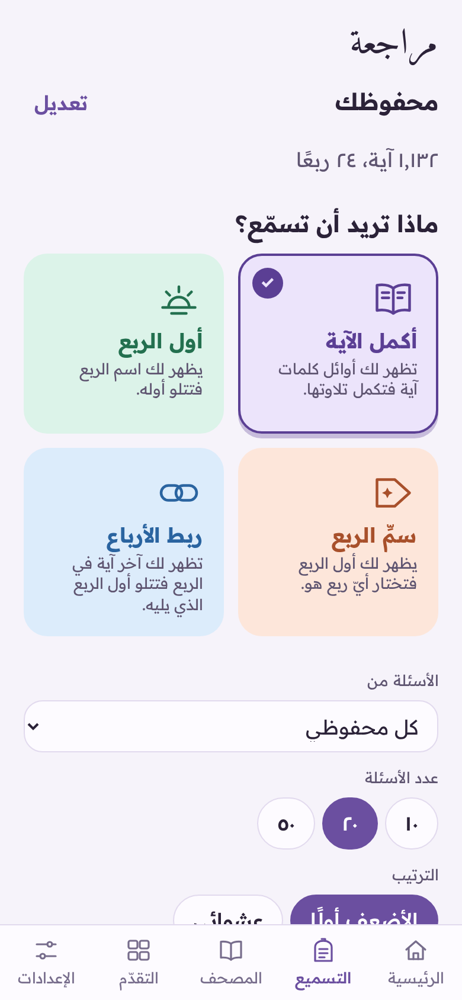
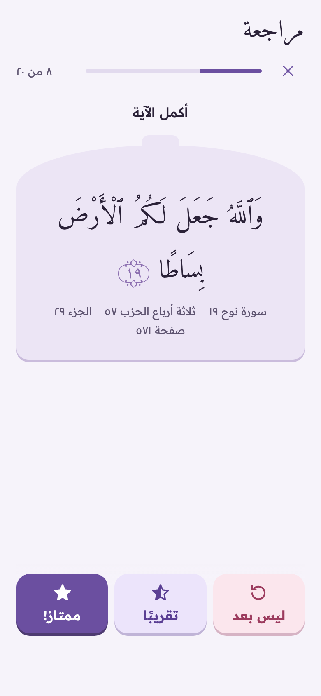
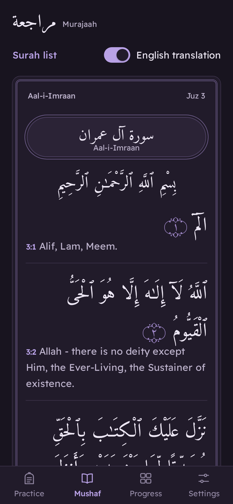
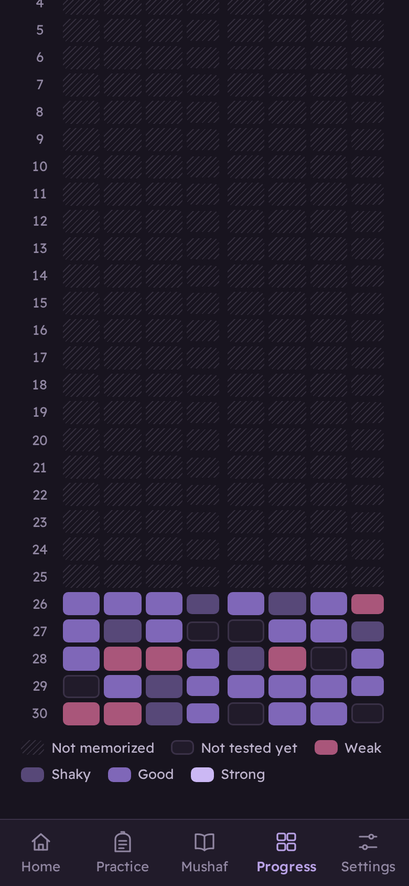

<div align="center">


# Murajaah · مراجعة

**Revise your Qur'an memorization by rub' and by ayah.**
راجِع حفظك للقرآن الكريم بالأرباع والآيات.

[](https://github.com/Noorul-Ayn/murajaah-revision-/actions/workflows/ci.yml)

**[Open the app](https://noorul-ayn.github.io/murajaah-revision-/)**

</div>

Murajaah quizzes you on what you've memorized, and has the full mushaf to read page by page, with an optional English translation. You recite out loud, reveal the answer and mark how it went. The app remembers which ayahs and quarters are weak and asks those more often, using spaced repetition. It works offline, installs on your phone like an app, and can sync your progress across devices.

<p align="center">
  
  
  
  
</p>

## What it quizzes

| Mode | You see | You do |
| --- | --- | --- |
| **Continue the ayah** (أكمل الآية) | The first few words of an ayah | Recite the rest, and optionally the next 1–3 ayahs |
| **Start of a rub'** (أول الربع) | A quarter by name, e.g. *½ Hizb 27* | Recite how it begins |
| **Name the rub'** (سمِّ الربع) | How a quarter begins | Pick which quarter it is (checked automatically) |
| **Link the quarters** (ربط الأرباع) | The last ayah of a quarter | Recite how the next quarter begins |

- **Only what you've memorized.** Choose by juz, hizb, surah or any ayah range, and questions only come from there.
- **Weakest first.** Every ayah and quarter has its own memory strength (the [FSRS](https://github.com/open-spaced-repetition/ts-fsrs) algorithm). Missed items come back later in the same session and sooner in future ones.
- **Honest hints.** Reveal one more word, or the surah name. Using a word hint caps that answer at *hesitated*.
- **Progress map.** All 240 quarters, juz by juz, coloured from weak to strong.
- **The full mushaf.** Open any surah or juz and read the 604 Madani pages one by one, with surah headers and the basmala. Turn pages with the buttons, by swiping, or with the arrow keys, or jump straight to a page number. The app remembers where you stopped.
- **English translation.** Turn it on in the reader to see each ayah followed by its meaning: Saheeh International or Pickthall, chosen in Settings.
- **Arabic and English**, with full right-to-left layout, light and dark themes and three Qur'an text sizes.
- **Offline and installable.** The whole mushaf is bundled; after the first visit it works without a connection.
- **Accounts and sync (optional).** Sign in with an emailed link (or a code, if your Supabase project sends one) to keep progress in step across devices. Without an account everything stays on the device. You can also download and restore a backup file.

## The Qur'an text

The text is the [Tanzil Project](https://tanzil.net)'s verified **Uthmani text, riwayat Hafs**, used unchanged and displayed in the Amiri Quran typeface.

The reader follows the page divisions of the Madani mushaf (604 pages). The text flows within each page rather than reproducing the printed line breaks.

The English translations come from Tanzil: **Saheeh International** (distributed for non-commercial use) and **Pickthall** (1930, public domain). Each is loaded only when you turn the translation on, and is then kept for offline use. A translation conveys the meaning and is not the Qur'an itself.

Rub', juz and page boundaries are checked three ways: against Tanzil's metadata, against the rub' signs (۞) written in the text itself, and against [quran.com](https://quran.com)'s independent data. All 30 juz, 240 quarters and 604 pages agree, with one correction: Tanzil's metadata places the quarter in Al-Hijr at 15:50, but the rub' sign in the text, the printed Madani mushaf and quran.com all have it at **15:49** (نَبِّئْ عِبَادِىٓ). The build uses 15:49 and records the correction. See [`scripts/build-data.mjs`](scripts/build-data.mjs) and [`tests/data.test.ts`](tests/data.test.ts).

## Getting started

You need [Node.js](https://nodejs.org) 22 or newer.

```bash
npm install
npm run dev          # http://localhost:5173
```

This runs the app without accounts; everything is stored in your browser. To turn on sign-in and sync, follow [docs/SETUP.md](docs/SETUP.md).

| Command | What it does |
| --- | --- |
| `npm run dev` | Start the development server |
| `npm run build` | Typecheck and build to `dist/` |
| `npm run preview` | Serve the built app (service worker included) |
| `npm test` | Unit tests: data checks, quiz engine, storage, sync and the database migration |
| `npm run test:e2e` | End-to-end tests in Chromium at phone and desktop sizes |
| `npm run check` | Typecheck, lint, formatting and unit tests together |
| `npm run data:fetch` | Download the latest Tanzil files into `data/tanzil/` |
| `npm run data:build` | Rebuild `src/data/quran-hafs.json` and the translations from them |
| `npm run data:check` | Re-check boundaries against quran.com |

## Deploying

Every push to `main` runs the tests and, if they pass, publishes the app to **GitHub Pages**. One-time setup is in [docs/SETUP.md](docs/SETUP.md#2-publish-on-github-pages).

## How it's built

React and TypeScript on Vite, installable as a PWA. Progress lives in IndexedDB on the device. Sync uses Supabase (Postgres with row-level security, so each account can only ever read its own rows).

Every answer is stored as an immutable review, and an item's memory state is always recomputed by replaying its reviews in order. Syncing is therefore a simple union of reviews between devices, and every device arrives at the same state. Two devices can be used offline at the same time without conflicts.

```
src/
  lib/          quiz engine: Qur'an lookups, words, scope, items, FSRS, sessions, progress
  storage/      IndexedDB (reviews, derived item states, settings) and backups
  sync/         Supabase client and two-way sync
  app/          React context for app state and sync
  screens/      Practice, Quiz, Summary, Progress, Memorized, Mushaf (index and pages), Settings, Account
  components/   Qur'an text rendering and shared controls
  i18n/         Arabic and English text
  data/         quran-hafs.json and translations/ (generated; do not edit)
data/tanzil/    verbatim Tanzil source files (text, metadata, translations)
supabase/       database migration
scripts/        data download, build and cross-check
tests/ e2e/     Vitest and Playwright tests
```

## Contributing

Corrections and improvements are welcome. Please read [CONTRIBUTING.md](CONTRIBUTING.md). If you find a mistake in the Qur'an text or in a boundary, open an issue with the surah and ayah.

## Licence

The code is released under the [MIT licence](LICENSE). The Qur'an text is © Tanzil Project, used under [Creative Commons Attribution 3.0](https://creativecommons.org/licenses/by/3.0/) on the condition that it is copied verbatim. The Saheeh International translation is for non-commercial use only; anyone using this code commercially must remove it or get the publisher's permission. The Amiri Quran and Readex Pro typefaces are under the SIL Open Font Licence. Details are in [NOTICE.md](NOTICE.md).
